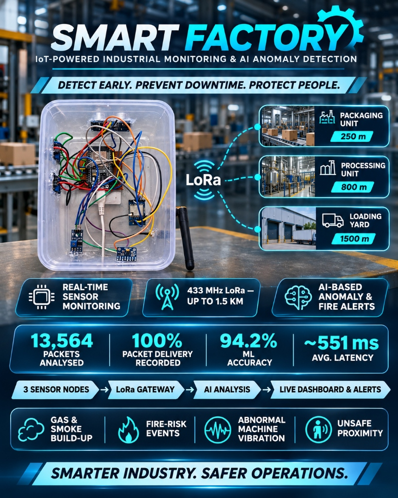

<div align="center">

# 🏭 Smart Factory: IoT-Powered Industrial Monitoring & AI Anomaly Detection

**"Detect Early. Prevent Downtime. Protect People."**

An end-to-end industrial safety and telemetry platform built for high-risk manufacturing and chemical processing environments. Powered by long-range **Sub-GHz LoRa mesh nodes**, **edge vision**, **sensor fusion**, and a real-time **Flask + React control center**.

---



---

### 📊 Real-World Test Bench Metrics
| 📦 13,564 | 📡 100% | 🧠 94.2% | ⚡ ~551 ms |
| :---: | :---: | :---: | :---: |
| **Packets Analyzed** | **Packet Delivery Rate** | **Anomaly Detection Accuracy** | **Average End-to-End Latency** |

</div>

---

## 🌟 Overview & Real-World Problems Solved

Industrial plants (such as chemical blending, processing, and heavy manufacturing facilities) face unique safety challenges that off-the-shelf consumer IoT cannot handle:

1. **The "Faraday Cage" Effect (Industrial Wi-Fi Failure)**
   * *Problem:* Heavy steel reactors, metal walls, and machinery completely block 2.4GHz Wi-Fi signals.
   * *Solution:* **433 MHz SX1278 LoRa** penetrates dense industrial metal structures over 80m–300m indoors and up to **1.5 km across plant yards** without requiring factory-wide Wi-Fi repeaters.

2. **False Alarms vs. Catastrophic Fire Events**
   * *Problem:* Single optical flame sensors trigger false shutdowns from welding sparks or reflections, costing plants tens of thousands in lost downtime.
   * *Solution:* **Multi-Sensor Fusion Algorithm** correlates optical flame persistence windows with MQ smoke/gas rate-of-rise moving averages. Alarms sound only when verified, eliminating costly false alarms while catching pre-combustion vapor leaks early.

3. **Conveyor Bearing Seizures & Spark Prevention**
   * *Problem:* Unbalanced motors and failing conveyor bearings generate extreme friction heat—a critical explosion hazard near flammable solvents.
   * *Solution:* **Continuous 3-Axis MPU6050 Vibration Tracking** flags mechanical wear and motor imbalances before friction generates sparks or motor seizure.

4. **Worker Proximity & Pinch-Point Hazards**
   * *Problem:* Automated conveyor lines and moving chemical drums risk crushing injuries and dangerous chemical spills.
   * *Solution:* **Ultrasonic (HC-SR04) Proximity Interlocks** continuously monitor clearance zones, flagging jams and boundary violations instantly.

5. **"Ghost Alarm" Verification (Edge Vision)**
   * *Problem:* Control room operators cannot tell if a raw sensor trip is steam, cleaning spray, or an actual fire without sending personnel into harm's way.
   * *Solution:* **ESP32-CAM Visual Ingest** provides instant visual verification snapshots and video stream directly onto the operator dashboard.

6. **Zero-Data-Loss Fail-Safe**
   * *Problem:* Network drops during an emergency can erase vital diagnostic telemetry.
   * *Solution:* **Gateway Store-and-Forward Buffer** queues sensor telemetry in hardware with exponential backoff, ensuring zero lost packets when the backend reconnects.

---

## 🏗️ System Architecture

```text
  [ Zone 1: Processing Unit (800m) ] ──┐
  [ Zone 2: Packaging Unit  (250m) ] ──┼──> [ 433 MHz LoRa Gateway ]
  [ Zone 3: Loading Yard   (1500m) ] ──┘            │
                                                    │ USB Serial / HTTP
                                                    ▼
  [ ESP32-CAM Live Vision ] ────────────> [ Flask REST Ingestion Engine ]
                                                    │
                                                    ├──> MySQL Database
                                                    └──> WebSocket / SSE
                                                            │
                                                            ▼
                                              [ React + Tailwind Dashboard ]
                                              (Worker & Manager Portals)
```

---

## 📁 Repository Structure

```text
├── assets/
│   └── smart_factory_poster.jpg    # High-resolution project poster & schematics
├── arduino/
│   ├── sender1/sender1.ino         # Node 1: Processing Unit firmware
│   ├── sender2.ino                 # Node 2: Packaging Unit firmware
│   ├── sender3/sender3.ino         # Node 3: Loading Yard firmware
│   ├── gateway/gateway.ino         # Central LoRa receiver & store-and-forward gateway
│   └── receiver/receiver.ino       # Alternative serial receiver node
├── backend/
│   ├── app.py                      # Flask REST API, authentication, alert dispatch
│   ├── serial_bridge_ingest.py     # USB-to-database live serial ingestion bridge
│   ├── setup_db.sql                # Complete MySQL schema & relational tables
│   ├── seed_demo_data.py           # Synthetic sensor data generator for testing
│   └── requirements.txt            # Python dependencies
├── factory-pulse-ai-main/          # Modern React 18 + Vite + Tailwind CSS Dashboard
│   ├── src/
│   │   ├── pages/                  # Manager Dashboard, Worker View, Reports, Alerts
│   │   ├── components/             # Reusable UI widgets, telemetry gauges, live charts
│   │   └── api/                    # API clients and WebSocket integrations
│   ├── package.json
│   └── vite.config.ts
└── docs/                           # Hardware datasheets, network reliability benchmarks
```

---

## 🛠️ Tech Stack & Hardware Components

### Hardware
* **Microcontrollers:** ESP32-WROOM-32, ESP32-CAM (AI-Thinker)
* **RF Transceivers:** Semtech SX1278 LoRa (433 MHz)
* **Sensors:**
  * MQ-Series (Flammable Gas, VOCs, Smoke)
  * Optical Flame Sensor Module
  * MPU6050 (3-Axis Accelerometer & Gyroscope)
  * HC-SR04 (Ultrasonic Proximity & Obstacle Detection)
* **Indicators:** I2C LCD Display, status LEDs, active buzzer

### Software & Cloud
* **Embedded:** C++ / Arduino IDE / ESP-IDF
* **Backend:** Python 3.10+, Flask, Flask-JWT-Extended, PySerial
* **Database:** MySQL 8.0+
* **Frontend:** React 18, TypeScript, Vite, Tailwind CSS, Lucide Icons, Recharts

---

## 🚀 Quick Start Guide

### 1. Flash the Hardware
1. Open the `.ino` files in the `arduino/` folder inside the Arduino IDE.
2. Install the required libraries: `LoRa by Sandeep Mistry`, `Adafruit MPU6050`, `LiquidCrystal_I2C`.
3. Flash `sender1.ino`, `sender2.ino`, and `sender3.ino` to their respective node ESP32s.
4. Flash `gateway.ino` to the central receiver ESP32 connected to the host machine.

### 2. Configure Backend & Database
```bash
# Navigate to backend
cd backend

# Create virtual environment
python -m venv venv
source venv/bin/activate  # On Windows: .\venv\Scripts\activate

# Install dependencies
pip install -r requirements.txt

# Configure environment variables
cp .env.example .env
# Edit .env with your MySQL credentials

# Initialize MySQL tables
mysql -u root -p smartfactory < setup_db.sql

# Start the Flask API
python app.py

# In a separate terminal, launch the serial bridge ingest
python serial_bridge_ingest.py --port COM3 --baud 115200
```

### 3. Launch Frontend Dashboard
```bash
# Navigate to the frontend app
cd factory-pulse-ai-main

# Install dependencies
npm install

# Run the development server
npm run dev
```
Open [http://localhost:5173](http://localhost:5173) in your browser to access the live dashboard!

---

## 🔒 Safety Compliance & Security
* **Role-Based Access Control (RBAC):** Distinct roles for Plant Floor Workers and Safety Managers.
* **Persistent Event Logging:** Immutable event history with incident resolution tracking (`/api/alerts/resolve`).
* **Visual Audit Trail:** ESP32-CAM images timestamped and archived per alert event.

---

## 🤝 Contributing
Contributions, issues, and feature requests are welcome! Feel free to check the [issues page](https://github.com/adityathakre776-stack/SmartFactory-IoT-Monitoring-System/issues).

## 📄 License
This project is open-source and distributed under the **MIT License**.
